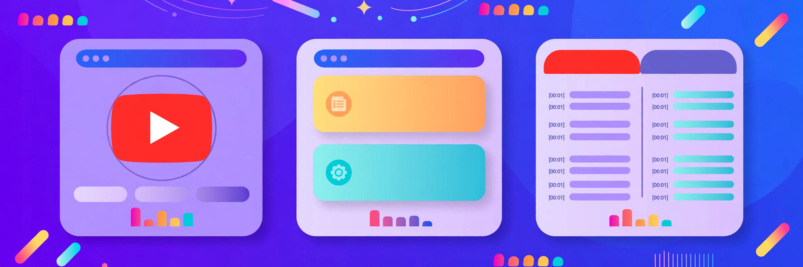

> **Historical documentation:** This file describes earlier releases and the classic workflow. Some claims, deployment instructions and limits are obsolete. For current behavior, see [README.md](README.md) and [STUDIO-README.md](STUDIO-README.md).

# Universal Transcription Studio — upgraded release

**Start here: [Universal Studio guide](STUDIO-README.md).** The new `index.html` is the audio-first verification studio on GitHub Pages and the computer. `Transcript.html` is the retained classic YouTube workflow; the historical documentation below describes that classic version. For the computer extract `offline-pack.zip` and double-click `Open_Transcriber.bat` (Python 3.12 is required). Optional Maximum dependencies are separate. No claim of 100% accuracy is made.

---

## Enhanced audio accuracy (latest update)

- Enabled by default on the transcript page; uncheck to avoid a second audio API request. Groq compares Large V3 and Turbo; OpenAI may repeat the same timed model without title bias.
- With a connected chat model, bounded, time-anchored differences can be selected from the two audio outputs only. Unsafe, unanchored, or malformed alternatives retain the primary transcript. Actual repetitions are preserved; near-identical duplicate observations are removed.
- Browser uploads and the Cloudflare helper support this mode. Redeploy the worker after updating the website. The API key field mismatch has been repaired. Gemini, captions-only, and local/MCP routes do not use this two-model browser reconciliation. Local CLI now prefers audio over generated captions.
- Text-only spelling review cannot hear audio. Exact lyrics, perfect timestamps, and completeness are not guaranteed; use authorized reference alignment and review against playback. YouTube access, file-size limits, rate limits, and model availability still apply. Extra API requests can incur charges.
- Run `python tests/test_timeline_browser.py` for browser regressions (requires Playwright and Chromium).

<p align="center">
  
</p>

<h1 align="center">YouTube Transcribe Downloader</h1>

<p align="center">
  <strong>Paste a YouTube link. Get timed words — second by second, in the original language, and in English letters with the right pronunciation.</strong>
</p>

<p align="center">
  
  
  
  
  
  
</p>

<p align="center">
  
</p>

<p align="center">
  <strong>🌐 Try it online — no install:</strong><br />
  <a href="https://abhishek6966.github.io/Youtube-Transcribe-Downloader/">https://abhishek6966.github.io/Youtube-Transcribe-Downloader/</a>
</p>

<p align="center">
  
</p>

---

## Timing and karaoke accuracy update

- The transcript now uses a chronological token timeline; the old word-set majority vote and unconditional repeat removal are no longer applied. Rolling caption carry-over is removed only when the caption windows or inline markers provide evidence. Real repeats are retained.
- **Play & sing along** uses the embedded YouTube player's current playback time to highlight both script columns, scroll and seek. Embedding or autoplay may be blocked by YouTube/browser; use the player's controls if autoplay is blocked.
- **Align reference** accepts a user-supplied authorized, complete original-language reference in performance order (including repetitions). Exact matched tokens retain timing; missing or corrected tokens between anchors are estimated and labelled as such. Weak matches or unsupported gaps are rejected. No lyrics are bundled or automatically fetched from a third-party lyrics site.
- Groq's full `whisper-large-v3` is preferred over turbo for accuracy, with fallback. Text-only AI checks are not audio verification. For songs, use the matching audio file or a configured audio-capable helper. Captions, Gemini time estimates and speech-model timestamps can still contain errors; manually verify important sections.
- TXT exports use whole-second grouping; SRT exports preserve fractional start/end times. The browser, worker, Python helper, MCP route and offline pack have been updated. Redeploy the worker separately if you use it.
- Verified with local browser regression tests (simulated player clock, rolling VTT, repeated words, reference alignment, and SRT); the live YouTube performance and external API credentials were not tested.

## What is this?

**YouTube Transcribe Downloader** turns any YouTube video into a clean, timed transcript — the words a song or video actually says, lined up second by second.

It was built for one simple frustration: other tools are slow, and they get song lyrics wrong. This one is different:

- **Captions first.** If the video already has captions, it uses them — in seconds, and exact when the captions are manual.
- **Two files, every time.** One file in the original language and script. A second file with the *same* words written in English letters, with the correct pronunciation spelling, word by word.
- **Second-by-second timestamps.** No milliseconds, no clutter. Just `[00:00:01] the words`.
- **Optional API key — for speed.** Paste a Groq, OpenAI or Gemini key (or one OpenRouter key for 100+ providers) and transcription gets much faster and sharper.
- **Made for everyone.** No technical words, no terminal needed for the easy way. Paste a link, tap one button, save both files.
- **Use it from any AI assistant.** An MCP server is included — plug it into Claude Desktop, Cursor, VS Code or Claude Code and ask for a transcript in plain words. ([How →](#use-it-inside-any-ai-assistant--mcp-server--skill))

---

## Three ways to use it

| | **Way 1 — Online (recommended)** | **Way 2 — Offline (your computer)** | **Way 3 — Inside any AI assistant (MCP)** |
|---|---|---|---|
| **You need** | Nothing installed. Just the website. | Python 3.10+ and FFmpeg, once | Python 3.10+, one line in your assistant's config |
| **YouTube link** | Paste it — captions are fetched online (needs the free helper below, one-time setup) | Paste it — captions, or Whisper on your computer | Just ask: *"transcribe this video"* — no key needed |
| **No captions?** | Upload the song's sound/video file — your key's provider listens to it online | Downloads the audio and transcribes it on your computer | The assistant sends the sound file to Whisper with your key |
| **API key** | Paste it in the bar at the top — it does everything online for you | Optional — same key, through the local server | Only for sound files — never stored, never logged |
| **Best for** | Anyone, anywhere, in a browser | You, on your own computer, no key needed | Any project, bot, or assistant — Claude, Cursor, VS Code |

### Publish it as a website (GitHub Pages, free)

1. Push this folder to a new GitHub repo.
2. Repo → **Settings → Pages → Build and deployment → Deploy from a branch** → branch `main`, folder `/ (root)` → **Save**.
3. Your site is live at `https://<your-name>.github.io/<repo-name>/` — anyone can open it, paste their own API key, and use it. No install, no terminal, nothing for them to download.

Live site: **https://abhishek6966.github.io/Youtube-Transcribe-Downloader/**

### The free helper — one-time setup, so YouTube links work online

A plain web page cannot pull the sound out of a YouTube video, and Groq / OpenAI / Gemini block direct calls from browsers. The tiny free worker in `worker/` does those two server-side jobs. Deploy it once (free Cloudflare account, `wrangler login`, `wrangler deploy`), put its address in the `WORKER_URL` setting at the top of `index.html`, and push. With the worker set, a connected Gemini key can also transcribe any link directly. Full steps are in [`worker/README.md`](worker/README.md).

> Honest limit: the worker code could not be tested live from the machine that wrote it, so try one captioned video through it first. And a video with **no captions** still needs its sound — the visitor uploads the sound/video file on the page, or uses the offline pack. No web page can pull audio out of a YouTube video on its own.

---

## See it in action

▶️ **Watch the full demo (22 seconds, 4K):** [youtube-transcribe-demo-4k.mp4](youtube-transcribe-demo-4k.mp4) — landing, choose your way, paste the link, tap Get the transcript, and the finished transcript in both languages, with the karaoke line at the end.

> **Step 1** — the landing. One screen, no scrolling.
>
> **Step 2** — choose your way: online with a key, or on your own computer, no key.
>
> **Step 3** — paste a YouTube link, tap **Get the transcript**, and watch the words appear.
>
> The finished transcript, in one panel with three tabs — **Side by side**, **Original**, **English letters**. Both versions next to each other with the same timestamps, each side scrolling inside its own box. No junk lines, no sound descriptions — words only.

---

## Use it inside any AI assistant — MCP server + skill

<p align="center">
  <strong>One file. No install beyond Python. Any assistant, any project — just ask for the words.</strong><br />
  <em>"Transcribe this video"</em> — and the assistant gets the same clean, timed transcript the website gives.
</p>

<p align="center">
  
  
  
  
  
</p>

The server is a single file — [`mcp-server/server.py`](mcp-server/server.py) — pure Python standard library, nothing to install. It speaks MCP (JSON-RPC over stdio) and gives any MCP client two tools:

| Tool | What it does |
|---|---|
| `transcribe_youtube(url, lang="auto")` | Captions first, same chain as the website: public Invidious mirrors raced in parallel → Piped → YouTube's legacy captions. **Free, no key.** |
| `transcribe_audio(audio_path_or_url, api_key, provider="groq")` | Sends a sound/video file to Groq or OpenAI Whisper — for videos with **no captions**. Needs your key, for that one call only. |

Both tools return the same two timed versions, line for line:

```text
[00:26] तू अगर मेरी ये हवाएं तेरी
[00:26] too agara meree ye havaaen teree
```

Original language **and** English letters, spelled the way they sound — never a translation. Sound descriptions (`[music]`, `[Sangeet]`, `[म्यूसिक]`, `[BLANK_AUDIO]`, `(pause)`, `♪ tune ♪` …) are stripped, and words are never invented: if a video has no captions and no key is given, the tool says so plainly.

### Set it up — one block, 30 seconds

**Claude Desktop** — edit `claude_desktop_config.json` (macOS: `~/Library/Application Support/Claude/`, Windows: `%APPDATA%\Claude\`):

```json
{
  "mcpServers": {
    "youtube-transcribe-downloader": {
      "command": "python3",
      "args": ["/absolute/path/to/youtube-transcribe-downloader/mcp-server/server.py"]
    }
  }
}
```

**Cursor** — Settings → MCP → Add new global MCP server (or edit `~/.cursor/mcp.json`), same block as above.

**VS Code** — in `.vscode/mcp.json`, same block but under `"servers"` instead of `"mcpServers"`.

**Claude Code / Muse** — one command:

```bash
claude mcp add youtube-transcribe-downloader -- python3 /absolute/path/to/youtube-transcribe-downloader/mcp-server/server.py
```

> On Windows, use `python` instead of `python3` if that is what your install is called, and use forward slashes in the path (`C:/path/to/mcp-server/server.py`). Restart your assistant after adding it — the two tools then appear in its tools list.

### Try it without any setup

```bash
cd mcp-server
printf '%s\n' \
  '{"jsonrpc":"2.0","id":1,"method":"initialize","params":{}}' \
  '{"jsonrpc":"2.0","id":2,"method":"tools/list"}' \
  '{"jsonrpc":"2.0","id":3,"method":"tools/call","params":{"name":"transcribe_youtube","arguments":{"url":"https://youtu.be/GVizJ_jpUnw"}}}' \
  | python3 server.py
```

### The skill — for agents and projects

[`mcp-server/SKILL.md`](mcp-server/SKILL.md) is the agent skill: when to use each tool, what comes back, and the rules the tools already follow (captions first, words only, never invent words, keys stay private). Drop it into any agent's skills folder and it knows how to transcribe. Full details: [`mcp-server/README.md`](mcp-server/README.md).

> Honest limits: a video with **no captions** cannot be done from the link alone — the server cannot pull YouTube audio, same as the web page. Audio files over 25 MB are refused. Sung words can still be misheard.

---

## Features

| Feature | What it does |
|---|---|
| 🎵 **Captions first** | Uses the video's own captions when they exist — fast and exact if they are manual. Auto captions are labelled as auto. |
| ⚡ **Fast Whisper fallback** | No captions? Falls back to Whisper `large-v3-turbo` on your own computer — about 5–6× faster than the old `large-v3` model. |
| 🌍 **Language picker** | Auto-detect by default, or pick a language yourself — English, Hindi, Spanish, French, Japanese, Korean, Tamil, Bengali, Telugu, Russian, Greek and more. |
| 📄 **Two separate files** | **File 1** — the words in the original language and script. **File 2** — the same words in English letters, with correct pronunciation spelling, word by word. |
| ⏱️ **Second-by-second timestamps** | `[00:00:00]`, `[00:00:01]`, `[00:00:02]`… seconds only. (`.srt` files keep milliseconds, because the SRT format requires them.) |
| 🔑 **API key — one bar, automatic** | Paste any provider key in the small bar at the top and tap **Fetch & Connect**. It detects the provider from the key, fetches all its models, and connects the best one for lyrics automatically. |
| 🧠 **AI word check** | When a key is connected, the model checks the words and fixes clear mistakes before you save. |
| 🎧 **Listen with a key** | With a Groq, OpenAI or Gemini key, the provider can listen to a sound file you pick and write the words down with times itself. |
| 🗂️ **Side-by-side transcript tabs** | One panel, three tabs — **Side by side**, **Original**, **English letters**. Both versions next to each other with the same timestamps, each side scrolling inside its own box, no page scroll. |
| 🎨 **Premium, simple design** | Colourful, clean, fully responsive. No technical details on screen — made for normal users, not engineers. |
| 🔒 **Your key stays yours** | The key lives only in your open browser tab. It is never saved to a file, never sent to us, and only ever sent to the provider it belongs to. |

### Example output

**File 1 — original language (`song.txt`)**

```
[00:00:00] हम तुम
[00:00:01] मिल गए
[00:00:02] तो दिल ये
```

**File 2 — English letters, pronunciation (`song - English letters.txt`)**

```
[00:00:00] ham tum
[00:00:01] mil gae
[00:00:02] to dil ye
```

---

## Quick start

### The easy way — just the web page (Windows)

No install. No terminal.

1. Download this project (Code → Download ZIP) and unzip it.
2. Double-click **`Open_Transcriber.bat`** — the page opens in your browser.
3. Paste a YouTube link, pick a language (or leave it on Auto), tap **Get the transcript**.
4. Tap **Save both files**.

> The page on its own fetches captions. For Whisper transcription and API-key transcription of YouTube audio, use the local server way below.

### The local server way — full power (Windows)

1. Install [Python 3.10+](https://www.python.org/downloads/) and [FFmpeg](https://ffmpeg.org/download.html) (needed for audio).
2. Double-click **`start_html.bat`** — it installs what it needs and opens the page at `http://127.0.0.1:8765`.
3. Paste a link and tap **Get the transcript**. If the video has no captions, it downloads the audio and transcribes it on your computer.

### The command way — one video at a time

```bat
run_transcript_v2.bat https://www.youtube.com/watch?v=dQw4w9WgXcQ
```

The two files appear in the `transcripts/` folder.

---

## API key — faster transcribing

On the top of the page there is one small bar: **paste your API key, tap Fetch & Connect**. Everything else happens behind the scenes.

| Provider | Key starts with | What it does here |
|---|---|---|
| **Groq** | `gsk_…` | Fastest pick — Whisper `large-v3-turbo`, free tier available |
| **OpenAI** | `sk-…` / `sk-proj-…` | Whisper `whisper-1` |
| **Google Gemini** | `AIza…` | Key is recognised (audio transcription via Gemini is not built in yet) |
| **OpenRouter** | `sk-or-…` | **One key opens models from 100+ providers** |
| **DeepSeek** | `sk-…` | Recognised, but text-only — it cannot transcribe audio |
| **NVIDIA, Anthropic, xAI, Perplexity, Fireworks, Cerebras, Zhipu, Hugging Face** | their own key shapes | Recognised; transcription depends on the provider |

How it works:

1. The key's shape tells us which provider it belongs to — keys carry no company label, so only known shapes are recognised, and nothing is ever guessed.
2. The key is checked with **that provider only** — it is never sent to any other provider.
3. All of that provider's models are fetched, and the best one for lyrics is picked automatically. You can change it in the dropdown.
4. The connected model is then used to check the words and fix clear mistakes, and (Groq / OpenAI) to listen to audio.

> ⚠️ **Never paste your API key in a chat, a screenshot, or a GitHub issue.** Paste it only in the bar on your own computer. It is never written to disk by this project.

---

## How it works

```
YouTube link
    │
    ├─► Has captions? ──► Use them (seconds, exact if manual)
    │
    └─► No captions? ──► Download audio ──► Whisper large-v3-turbo
    │                                    or your connected API model
    ▼
Word timestamps → grouped second by second
    ▼
Original language  +  English-letters pronunciation (romanization)
    ▼
Two files, saved:  song.txt  +  song - English letters.txt
```

- **Captions** come from the video itself via `youtube-transcript-api`.
- **Audio** is downloaded with `yt-dlp` and transcribed with `faster-whisper` (`large-v3`, `beam_size=5`, language detected once — not five times).
- **Romanization** (English-letters pronunciation) is done word by word for Hindi, Tamil, Bengali, Telugu, Japanese, Korean, Russian, Greek, Spanish and more.
- **The server** (`server.py`) is a small local Python server on `127.0.0.1:8765`. It never sends your data anywhere except to YouTube for captions/audio, and to your chosen AI provider when you connect a key.

---

## Project structure

```
youtube-transcribe-downloader/
├── index.html               # The website — GitHub Pages serves this
├── Transcript.html          # Same app, for opening on your computer
├── Open_Transcriber.bat     # Double-click: opens Transcript.html
├── start_html.bat           # Double-click: starts the local server + page
├── server.py                # Local server: captions, API-key connect, Whisper fallback
├── yt_transcript_v2.py      # Command-line version (captions → Whisper → two files)
├── run_transcript_v2.bat    # Double-click / command-line runner
├── worker/                  # Optional free Cloudflare Worker (online captions + audio forwarding)
│   ├── worker.js
│   ├── wrangler.toml
│   └── README.md
├── mcp-server/              # MCP server + agent skill — use it from any AI assistant
│   ├── server.py            # One file, pure Python stdlib, no installs
│   ├── SKILL.md             # The agent skill: when + how to use the tools
│   └── README.md            # Setup for Claude Desktop, Cursor, VS Code, Claude Code
├── docs/
│   └── images/              # Banner, logo and preview used in this README
├── transcripts/             # Your saved files go here (created automatically)
├── README.md
├── LICENSE                  # MIT
└── .gitignore
```

---

## Requirements

| Way | Needs |
|---|---|
| Web page only | A modern browser (Chrome / Edge / Firefox) |
| Local server / command line | Python 3.10+, FFmpeg, internet |
| API-key transcription | A key from Groq, OpenAI or OpenRouter (optional) |

Install the Python parts once:

```bash
pip install -r requirements.txt
```

> `requirements.txt` is created by `start_html.bat` on first run if it is missing. The main packages are `faster-whisper`, `yt-dlp` and `youtube-transcript-api`.

---

## Frequently asked questions

**Is it really free?**
Yes. The app, the captions route and the on-computer Whisper route cost nothing. An API key is optional — Groq has a free tier; OpenAI charges a small amount per minute of audio.

**Will the lyrics be 100% perfect?**
Honestly, no tool can promise that for sung words. Manual captions can still be incomplete or out of sync. Auto captions and Whisper can mishear a sung word, and no checker can recover a word that was never heard correctly. This tool gets as close as possible: captions first, the fastest Whisper model, and an AI word check when a key is connected.

**Why is it slow on my computer sometimes?**
The first run downloads the Whisper model (~1.5 GB for `large-v3-turbo`). After that, a 3-minute song usually takes well under a minute on a normal computer. Using a Groq key is the fastest option — the audio is transcribed on Groq's servers in seconds.

**Why do some videos show no captions?**
Some videos have captions turned off, or YouTube blocks the request from some networks. Try the local server way, or use a video that has captions.

**Do you store my API key or my videos?**
No. Your key stays in your browser tab and is never saved. Nothing you transcribe is uploaded anywhere except to the provider you chose, for the transcription itself.

**Can I use it for a video in my language?**
Yes — pick the language in the dropdown, or leave it on Auto. The second file always gives you the same words in English letters, so you can read the pronunciation even if you can't read the script.

---

## Contributing

Contributions are welcome! Here's how:

1. Fork this repo.
2. Create a branch: `git checkout -b my-improvement`.
3. Make your change, keeping the design simple and the words on screen non-technical.
4. Open a pull request and describe what you changed and how you tested it.

Please don't include API keys, passwords or personal data in any issue or pull request.

---

## License

This project is licensed under the **MIT License** — see the [LICENSE](LICENSE) file. Free to use, copy, change and share, with attribution.

---

## Disclaimer

- This tool is for personal use — getting the words of videos you watch, for learning, singing along, or study.
- Respect the creators: don't re-upload or sell transcripts of someone else's work. Follow YouTube's Terms of Service and your local copyright law.
- Transcripts are generated from captions or speech recognition and may contain errors, especially for sung lyrics. Always check important words against the original video.

---

<p align="center">
  <strong>Made with care — paste a link, get the words.</strong><br />
  ⭐ If this helped you, please star the repo — it helps others find it.
</p>
