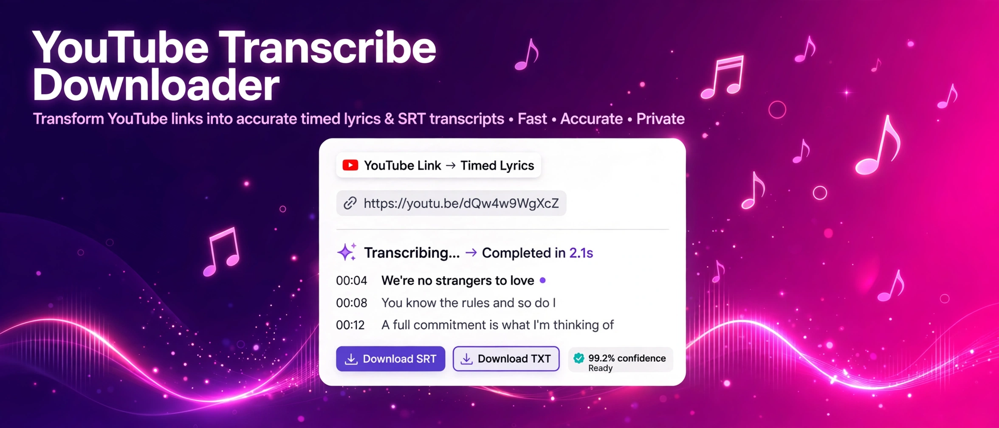
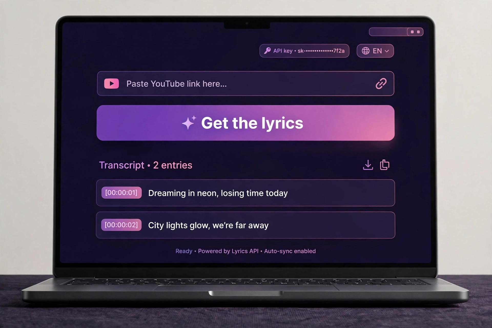

<p align="center">
  
</p>

<h1 align="center">YouTube Transcribe Downloader</h1>

<p align="center">
  <strong>Paste a YouTube link. Get the exact words — second by second, in the original language, and in English letters with the right pronunciation.</strong>
</p>

<p align="center">
  <strong>🌐 Try it online — no install:</strong><br />
  <a href="https://abhishek6966.github.io/Youtube-Transcribe-Downloader/">https://abhishek6966.github.io/Youtube-Transcribe-Downloader/</a>
</p>

<p align="center">
  <a href="#quick-start"></a>
  
  
  
  
</p>

<p align="center">
  
</p>

---

## What is this?

**YouTube Transcribe Downloader** turns any YouTube video into a clean, timed transcript — the words a song or video actually says, lined up second by second.

It was built for one simple frustration: other tools are slow, and they get song lyrics wrong. This one is different:

- **Captions first.** If the video already has captions, it uses them — in seconds, and exact when the captions are manual.
- **Two files, every time.** One file in the original language and script. A second file with the *same* words written in English letters, with the correct pronunciation spelling, word by word.
- **Second-by-second timestamps.** No milliseconds, no clutter. Just `[00:00:01] the words`.
- **Optional API key — for speed.** Paste a Groq or OpenAI key (or one OpenRouter key for 100+ providers) and transcription gets much faster and sharper.
- **Made for everyone.** No technical words, no terminal needed for the easy way. Paste a link, tap one button, save both files.

---

## Two ways to use it

| | **Way 1 — Online (recommended)** | **Way 2 — Offline (your computer)** |
|---|---|---|
| **You need** | Nothing installed. Just the website. | Python 3.10+ and FFmpeg, once |
| **YouTube link** | Paste it — captions are fetched online (needs the free helper below, one-time setup) | Paste it — captions, or Whisper on your computer |
| **No captions?** | Upload the song's sound/video file — your key's provider listens to it online | Downloads the audio and transcribes it on your computer |
| **API key** | Paste it in the bar at the top — it does everything online for you | Optional — same key, through the local server |
| **Best for** | Anyone, anywhere, in a browser | You, on your own computer, no key needed |

### Publish it as a website (GitHub Pages, free)

1. Push this folder to a new GitHub repo.
2. Repo → **Settings → Pages → Build and deployment → Deploy from a branch** → branch `main`, folder `/ (root)` → **Save**.
3. Your site is live at `https://<your-name>.github.io/<repo-name>/` — anyone can open it, paste their own API key, and use it. No install, no terminal, nothing for them to download.

Live site: **https://abhishek6966.github.io/Youtube-Transcribe-Downloader/**

### The free helper — one-time setup, so YouTube links work online

A plain web page cannot pull the sound out of a YouTube video, and Groq / OpenAI block direct calls from browsers. The tiny free worker in `worker/` does those two server-side jobs. Deploy it once (free Cloudflare account, `wrangler login`, `wrangler deploy`), put its address in the `WORKER_URL` setting at the top of `index.html`, and push. Full steps are in [`worker/README.md`](worker/README.md).

> Honest limit: the worker code could not be tested live from the machine that wrote it, so try one captioned video through it first. And a video with **no captions** still needs its sound — the visitor uploads the sound/video file on the page, or uses the offline pack. No web page can pull audio out of a YouTube video on its own.

---

## See it in action

<p align="center">
  
</p>

> **Step 1** — paste a YouTube link.
> **Step 2** — tap **Get the transcript**.
> That's it.

---

## Features

| Feature | What it does |
|---|---|
| 🎵 **Captions first** | Uses the video's own captions when they exist — fast and exact if they are manual. Auto captions are labelled as auto. |
| ⚡ **Fast Whisper fallback** | No captions? Falls back to Whisper `large-v3-turbo` on your own computer — about 5–6× faster than the old `large-v3` model. |
| 🌍 **Language picker** | Auto-detect by default, or pick a language yourself — English, Hindi, Spanish, French, Japanese, Korean, Tamil, Bengali, Telugu, Russian, Greek and more. |
| 📄 **Two separate files** | **File 1** — the words in the original language and script. **File 2** — the same words in English letters, with correct pronunciation spelling, word by word. |
| ⏱️ **Second-by-second timestamps** | `[00:00:00]`, `[00:00:01]`, `[00:00:02]`… seconds only. (`.srt` files keep milliseconds, because the SRT format requires them.) |
| 🔑 **API key — one bar, automatic** | Paste any provider key in the small bar at the top and tap **Fetch & Connect**. It detects the provider from the key, fetches all its models, and connects the best one for lyrics automatically. |
| 🧠 **AI word check** | When a key is connected, the model checks the words and fixes clear mistakes before you save. |
| 🎧 **Listen with a key** | With a Groq or OpenAI key, the provider can listen to a sound file you pick and write the words down with times itself. |
| 🎨 **Premium, simple design** | Colourful, clean, fully responsive. No technical details on screen — made for normal users, not engineers. |
| 🔒 **Your key stays yours** | The key lives only in your open browser tab. It is never saved to a file, never sent to us, and only ever sent to the provider it belongs to. |

### Example output

**File 1 — original language (`song.txt`)**

```
[00:00:00] हम तुम
[00:00:01] मिल गए
[00:00:02] तो दिल ये
```

**File 2 — English letters, pronunciation (`song - English letters.txt`)**

```
[00:00:00] ham tum
[00:00:01] mil gae
[00:00:02] to dil ye
```

---

## Quick start

### The easy way — just the web page (Windows)

No install. No terminal.

1. Download this project (Code → Download ZIP) and unzip it.
2. Double-click **`Open_Transcriber.bat`** — the page opens in your browser.
3. Paste a YouTube link, pick a language (or leave it on Auto), tap **Get the transcript**.
4. Tap **Save both files**.

> The page on its own fetches captions. For Whisper transcription and API-key transcription of YouTube audio, use the local server way below.

### The local server way — full power (Windows)

1. Install [Python 3.10+](https://www.python.org/downloads/) and [FFmpeg](https://ffmpeg.org/download.html) (needed for audio).
2. Double-click **`start_html.bat`** — it installs what it needs and opens the page at `http://127.0.0.1:8765`.
3. Paste a link and tap **Get the transcript**. If the video has no captions, it downloads the audio and transcribes it on your computer.

### The command way — one video at a time

```bat
run_transcript_v2.bat https://www.youtube.com/watch?v=dQw4w9WgXcQ
```

The two files appear in the `transcripts/` folder.

---

## API key — faster transcribing

On the top of the page there is one small bar: **paste your API key, tap Fetch & Connect**. Everything else happens behind the scenes.

| Provider | Key starts with | What it does here |
|---|---|---|
| **Groq** | `gsk_…` | Fastest pick — Whisper `large-v3-turbo`, free tier available |
| **OpenAI** | `sk-…` / `sk-proj-…` | Whisper `whisper-1` |
| **Google Gemini** | `AIza…` | Key is recognised (audio transcription via Gemini is not built in yet) |
| **OpenRouter** | `sk-or-…` | **One key opens models from 100+ providers** |
| **DeepSeek** | `sk-…` | Recognised, but text-only — it cannot transcribe audio |
| **NVIDIA, Anthropic, xAI, Perplexity, Fireworks, Cerebras, Zhipu, Hugging Face** | their own key shapes | Recognised; transcription depends on the provider |

How it works:

1. The key's shape tells us which provider it belongs to — keys carry no company label, so only known shapes are recognised, and nothing is ever guessed.
2. The key is checked with **that provider only** — it is never sent to any other provider.
3. All of that provider's models are fetched, and the best one for lyrics is picked automatically. You can change it in the dropdown.
4. The connected model is then used to check the words and fix clear mistakes, and (Groq / OpenAI) to listen to audio.

> ⚠️ **Never paste your API key in a chat, a screenshot, or a GitHub issue.** Paste it only in the bar on your own computer. It is never written to disk by this project.

---

## How it works

```
YouTube link
    │
    ├─► Has captions? ──► Use them (seconds, exact if manual)
    │
    └─► No captions? ──► Download audio ──► Whisper large-v3-turbo
    │                                    or your connected API model
    ▼
Word timestamps → grouped second by second
    ▼
Original language  +  English-letters pronunciation (romanization)
    ▼
Two files, saved:  song.txt  +  song - English letters.txt
```

- **Captions** come from the video itself via `youtube-transcript-api`.
- **Audio** is downloaded with `yt-dlp` and transcribed with `faster-whisper` (`large-v3-turbo`, `beam_size=1`, language detected once — not five times).
- **Romanization** (English-letters pronunciation) is done word by word for Hindi, Tamil, Bengali, Telugu, Japanese, Korean, Russian, Greek, Spanish and more.
- **The server** (`server.py`) is a small local Python server on `127.0.0.1:8765`. It never sends your data anywhere except to YouTube for captions/audio, and to your chosen AI provider when you connect a key.

---

## Project structure

```
youtube-transcribe-downloader/
├── index.html               # The website — GitHub Pages serves this
├── Transcript.html          # Same app, for opening on your computer
├── Open_Transcriber.bat     # Double-click: opens Transcript.html
├── start_html.bat           # Double-click: starts the local server + page
├── server.py                # Local server: captions, API-key connect, Whisper fallback
├── yt_transcript_v2.py      # Command-line version (captions → Whisper → two files)
├── run_transcript_v2.bat    # Double-click / command-line runner
├── worker/                  # Optional free Cloudflare Worker (online captions + audio forwarding)
│   ├── worker.js
│   ├── wrangler.toml
│   └── README.md
├── docs/
│   └── images/              # Banner, logo and preview used in this README
├── transcripts/             # Your saved files go here (created automatically)
├── README.md
├── LICENSE                  # MIT
└── .gitignore
```

---

## Requirements

| Way | Needs |
|---|---|
| Web page only | A modern browser (Chrome / Edge / Firefox) |
| Local server / command line | Python 3.10+, FFmpeg, internet |
| API-key transcription | A key from Groq, OpenAI or OpenRouter (optional) |

Install the Python parts once:

```bash
pip install -r requirements.txt
```

> `requirements.txt` is created by `start_html.bat` on first run if it is missing. The main packages are `faster-whisper`, `yt-dlp` and `youtube-transcript-api`.

---

## Frequently asked questions

**Is it really free?**
Yes. The app, the captions route and the on-computer Whisper route cost nothing. An API key is optional — Groq has a free tier; OpenAI charges a small amount per minute of audio.

**Will the lyrics be 100% perfect?**
Honestly, no tool can promise that for sung words. Manual captions are exact. Auto captions and Whisper can mishear a sung word, and no checker can recover a word that was never heard correctly. This tool gets as close as possible: captions first, the fastest Whisper model, and an AI word check when a key is connected.

**Why is it slow on my computer sometimes?**
The first run downloads the Whisper model (~1.5 GB for `large-v3-turbo`). After that, a 3-minute song usually takes well under a minute on a normal computer. Using a Groq key is the fastest option — the audio is transcribed on Groq's servers in seconds.

**Why do some videos show no captions?**
Some videos have captions turned off, or YouTube blocks the request from some networks. Try the local server way, or use a video that has captions.

**Do you store my API key or my videos?**
No. Your key stays in your browser tab and is never saved. Nothing you transcribe is uploaded anywhere except to the provider you chose, for the transcription itself.

**Can I use it for a video in my language?**
Yes — pick the language in the dropdown, or leave it on Auto. The second file always gives you the same words in English letters, so you can read the pronunciation even if you can't read the script.

---

## Contributing

Contributions are welcome! Here's how:

1. Fork this repo.
2. Create a branch: `git checkout -b my-improvement`.
3. Make your change, keeping the design simple and the words on screen non-technical.
4. Open a pull request and describe what you changed and how you tested it.

Please don't include API keys, passwords or personal data in any issue or pull request.

---

## License

This project is licensed under the **MIT License** — see the [LICENSE](LICENSE) file. Free to use, copy, change and share, with attribution.

---

## Disclaimer

- This tool is for personal use — getting the words of videos you watch, for learning, singing along, or study.
- Respect the creators: don't re-upload or sell transcripts of someone else's work. Follow YouTube's Terms of Service and your local copyright law.
- Transcripts are generated from captions or speech recognition and may contain errors, especially for sung lyrics. Always check important words against the original video.

---

<p align="center">
  <strong>Made with care — paste a link, get the words.</strong><br />
  ⭐ If this helped you, please star the repo — it helps others find it.
</p>
