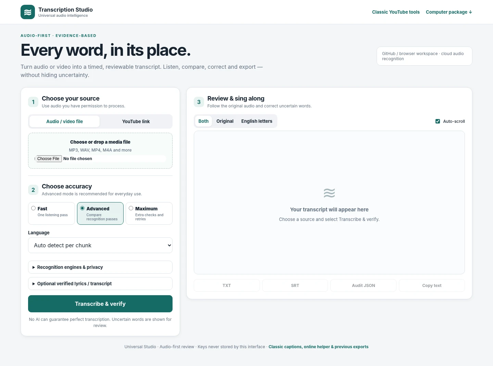
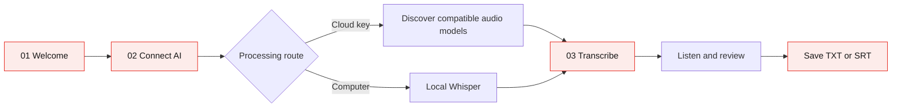
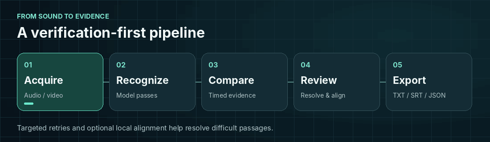
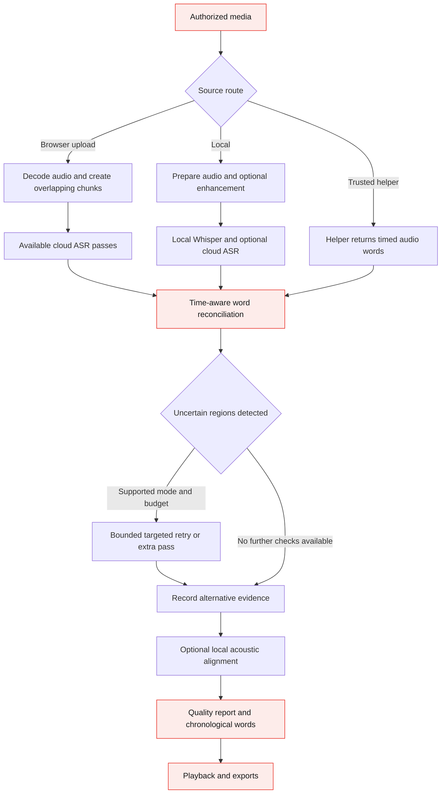
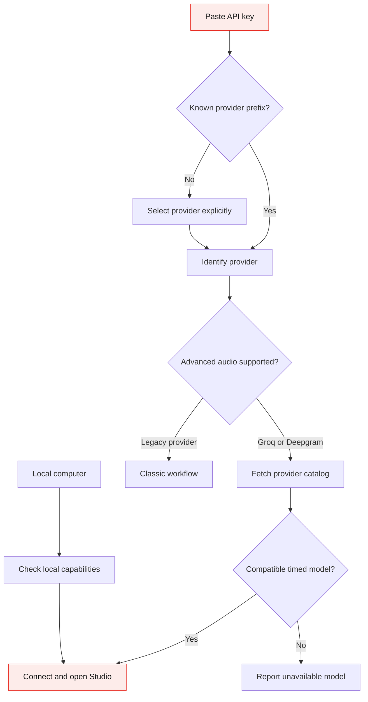
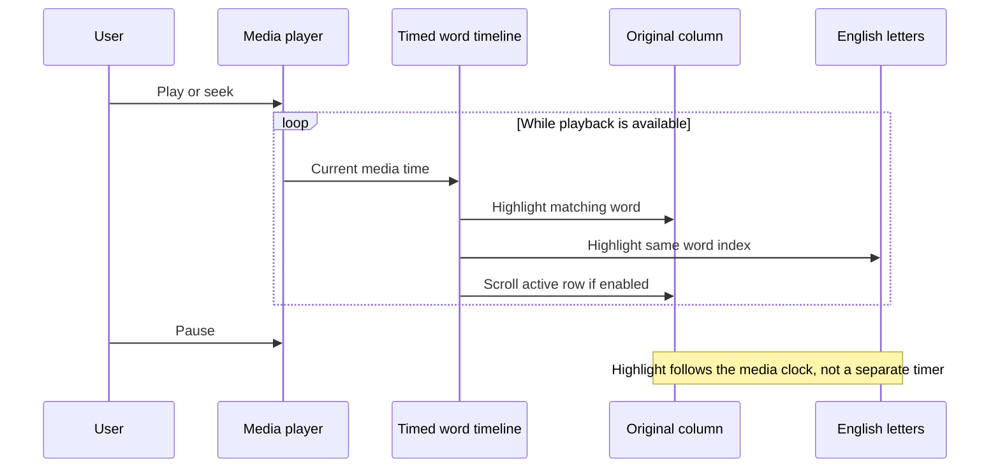
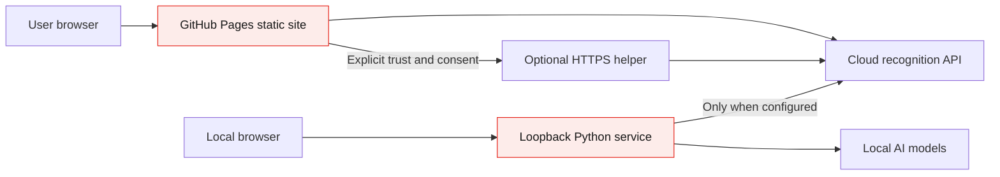

<div align="center">


# Universal Transcription Studio

**Every word, in its place.**

An audio-first AI workspace for transcription, evidence-based review, multilingual text and synchronized karaoke.


[](https://abhishek6966.github.io/Youtube-Transcribe-Downloader/)

**Live application:** [https://abhishek6966.github.io/Youtube-Transcribe-Downloader/](https://abhishek6966.github.io/Youtube-Transcribe-Downloader/) · **[Computer setup](#quick-start)** · **[Full technical guide](STUDIO-README.md)**

[Features](#what-makes-it-different) · [Architecture](#how-it-works) · [Capabilities](#capability-matrix) · [Testing](#testing-and-benchmarks) · [Privacy](#privacy-and-trust)

</div>

---

## A more trustworthy way to transcribe

Songs, interviews, lectures, podcasts and conversations deserve more than a text box full of guesses. Universal Transcription Studio compares available recognition passes, maintains a chronological word timeline, and exposes the evidence behind uncertain words so users can listen, review and correct them.

<table>
<tr>
<td width="33%" valign="top"><strong>01 · Listen</strong><br/>Use local Whisper or configured cloud recognition for authorized audio and video.</td>
<td width="33%" valign="top"><strong>02 · Verify</strong><br/>Compare timed alternatives, preserve genuine repetitions and review disputed words.</td>
<td width="33%" valign="top"><strong>03 · Use</strong><br/>Play along with the transcript, inspect word evidence and export your results.</td>
</tr>
</table>

<p align="center"></p>
<p align="center"><sub>Actual application screenshot · Browser workspace before transcription</sub></p>

> [!IMPORTANT]
> This studio is designed for measurable reliability, not a guarantee of perfect transcription. Model agreement is evidence, not ground truth. Unclear audio, accents, singing, unsupported languages and overlapping voices can still produce errors.

## Three-step studio

<p align="center"></p>
<p align="center"><sub>Actual application screenshots · animated tour, not live API results.</sub></p>

| 01 · Welcome | 02 · Connect AI | 03 · Transcribe |
| :---: | :---: | :---: |
|  |  |  |
| Animated welcome and Start | Paste a key or use local Whisper | Original-style two-panel workspace |



**Step 1 — Welcome.** Open the app and press Start. The original pastel video-card animation and transcription demonstration stay visible. Background motion pauses in a hidden tab and honors reduced-motion settings.

**Step 2 — Connect.** Paste a recognized API key or choose a provider if its key is ambiguous. Groq and Deepgram model catalogs are fetched from the provider; only supported timed models are selected. Local Whisper requires no cloud key. Other legacy providers use the retained Classic workflow. Use the optional trusted helper settings for browser-based YouTube audio acquisition.

**Step 3 — Transcribe.** Paste a YouTube link or choose a sound/video file. Select a language, review the discovered listening models, choose Fast, Advanced or Maximum, then select **Get the transcript**. The live equalizer, progress bar and elapsed timer reflect the processing job. The original and English-letter views share one timeline and scroll within the workspace. Advanced tools contain reference comparison, evidence, quality report and audit JSON.

| Workspace control | Behavior |
| :--- | :--- |
| Get the transcript | Runs the selected recognition route and accuracy mode. |
| Video preview | Shows the video thumbnail and ID; title/channel are retrieved when available. Playback depends on YouTube embedding. |
| Play & sing along | Plays or pauses the source and highlights recognized timed words. |
| Check the words | Offers a new Maximum-mode audio pass on the same recording; a successful run replaces the result, including manual edits, after confirmation. |
| Add them from a file | Imports timestamped TXT, SRT or VTT; cue-derived word times are estimates, not audio verification. |
| Save both files / Save as .srt | Exports original and romanized text or subtitle pairs. |
| Copy / Clear | Copies original text or clears the current result after confirmation. |
| Advanced tools | Opens reference text for the next recognition run, word evidence, quality report, audit export and a link to original Classic tools. |

Desktop has a fixed-height workspace; smaller viewports and expanded content may require internal panel scrolling, not outer-page scrolling. The complete original `Transcript.html` is still available for the classic caption-first route and legacy controls.

## What makes it different

| Feature | What it does |
| :--- | :--- |
| **Multi-model recognition** | Compare local faster-whisper, Groq Whisper variants and optional independent Deepgram results. |
| **Ordered word timeline** | Keep original word timings and chronological sequence; suppress overlapping observations without deleting genuine repeated words. |
| **Missing-word recovery** | Recover omissions supported by additional recognition routes, including supported opening and closing words. |
| **Targeted retries** | Re-listen to selected uncertain regions within a bounded retry budget. |
| **Optional acoustic processing** | On the computer, Maximum mode can use Demucs vocal isolation, noise reduction and WhisperX forced alignment when available. |
| **Multilingual transcription** | Automatically detect language per chunk; original-script and romanized views where supported. |
| **Evidence-based review** | Inspect word timestamps and competing predictions; optional AI context suggestions never silently rewrite the transcript. |
| **Karaoke playback** | Follow the shared playback clock with synchronized word highlighting and scrolling. |
| **Quality report** | Inspect processing coverage, corroboration, unresolved regions, provider evidence and warnings. |
| **Portable exports** | Save TXT, millisecond SRT subtitles and audit JSON. |

## Quick start

### Option A — Open the studio online

1. Open the [GitHub Pages studio](https://abhishek6966.github.io/Youtube-Transcribe-Downloader/).
2. Press **Start**, paste a Groq key or select Deepgram and connect. The app checks available models and advances to the workspace.
3. Select an authorized audio/video file, or enter a YouTube link and configure a trusted helper. Choose **Advanced** (default), leave language on **Auto** if unsure.
4. Click **Get the transcript**. Review the result, play the source, optionally check the words again, and export the transcript.

The web edition processes supported uploaded files in overlapping audio chunks. Browser access, CORS, media decoding and provider availability can affect this route. Cloud providers may charge for usage. The website alone does not fetch every YouTube stream.

### Option B — Run on your computer

**Windows**

1. Download [`offline-pack.zip`](offline-pack.zip) from this repository (or use the Computer package button on the website).
2. Extract the ZIP and install [Python 3.12](https://www.python.org/downloads/) if required.
3. Double-click **`Open_Transcriber.bat`**. The first run creates a private virtual environment and installs core dependencies.
4. The studio opens in your browser at **`http://127.0.0.1:8765/`**. Press Start, choose **On your computer**, continue, select a recording and click **Get the transcript**.

**macOS / Linux**

From the extracted directory, with a compatible Python installation (3.12 recommended):

```bash
sh start_studio.sh
```

No cloud key is needed when using the local Whisper recognition route. The first local job downloads model weights; allow several GB of storage, a reliable internet connection for setup, and adequate RAM. Subsequent local file jobs can run without audio API requests once dependencies and weights are installed. Close the terminal to stop the local service.

### Optional — Unlock Maximum mode's local models

Close the studio. On Windows double-click **`Install_Maximum_Models.bat`**. On macOS/Linux, after initial setup:

```bash
.venv/bin/python -m pip install -r requirements-maximum.txt
```

This installs optional Demucs and WhisperX dependencies. Model weights are downloaded separately when required. Compatibility and resource requirements vary. When a model is unavailable, the studio reports the fallback rather than claiming that alignment or isolation was performed.

## How it works

<p align="center"></p>

The studio first prepares audio, then processes overlapping chunks through the available recognition engines. The comparison engine aligns competing word sequences by text and time, preserving source evidence. Local Maximum mode can add vocal isolation, acoustic alignment and targeted audio retries. A final audit reports the completed checks and unresolved uncertainty.

| Engine / component | Role |
| :--- | :--- |
| faster-whisper / Whisper Large V3 and Turbo | General multilingual recognition, local or via Groq |
| Deepgram Nova-3 | Optional independent recognition and chunk-level speaker labels |
| Demucs | Optional computer-side vocal isolation |
| WhisperX | Optional computer-side acoustic alignment for supported languages |
| Groq text model | Optional contextual suggestions for disputed observed candidates |
| Python / JavaScript comparison engines | Time-aware reconciliation, evidence and quality checks |

The Python engine and browser JavaScript port have similar consensus goals, but are not identical implementations. Local processing supports capabilities that the static browser cannot execute.

### Recognition and evidence pipeline



### Automatic AI connection and routing



Catalog discovery verifies availability in the returned list, not actual transcription permissions or accuracy. Ambiguous keys are not sent to guessed providers. Provider calls may fail due to permissions, network or CORS.

## Choose your level of verification

<table>
<tr><td width="33%" valign="top"><h3>Fast</h3><strong>Quick recognition</strong><p>One listening pass with core validation.</p><sub>Lowest processing effort</sub></td>
<td width="33%" valign="top"><h3>Advanced</h3><strong>Recommended default</strong><p>Multiple available recognition passes and time-aware comparison.</p><sub>Balanced accuracy and processing effort</sub></td>
<td width="33%" valign="top"><h3>Maximum</h3><strong>Deeper verification</strong><p>Extra checks, bounded retries, and optional computer-side isolation and alignment.</p><sub>More time, memory and possible API cost</sub></td></tr>
</table>

Actual processing depends on installed models, credentials and supported audio. Selecting Maximum does not automatically make every optional engine available.

## Karaoke & word evidence

<p align="center"></p>
<p align="center"><sub>Illustrative animation · Original demonstration text, not a live recognition result</sub></p>

- Play the source recording, follow the timed words, and switch between **Side by side**, **Original** and **English letters**.
- Select a word to inspect recognition evidence and its timestamp, or seek to its interval when playback is available.
- Correct words manually with undo. Paste an authorized reference transcript to compare discrepancies without overwriting audio evidence.
- Export timed text, subtitles or the audit JSON for further inspection.

Word-level timings depend on source evidence and available alignment models. Syllable-level singing alignment is not implemented; YouTube embedding and autoplay may be restricted.

### Shared playback clock



## Capability matrix

| Capability | GitHub Pages | Computer |
| :--- | :---: | :---: |
| Audio/video file recognition | Cloud key | Local or cloud |
| Authorized YouTube links | Trusted helper | Subject to access |
| Groq / Deepgram | Supported | Supported |
| Local Whisper, no audio API key | — | Supported |
| Multi-pass comparison and evidence | Supported | Supported |
| Context suggestions / reference comparison | Supported | Supported |
| Noise reduction | — | Supported |
| Demucs vocal isolation | — | Optional |
| WhisperX forced alignment | — | Optional |
| Word playback / review / exports | Supported | Supported |
| Checkpoint recovery | — | Opt-in |
| File input limit | 200 MB | 512 MB |
| Audio duration limit | 1 hour | 4 hours |

The limits above apply to the new file-processing routes. The existing online helper has separate smaller limits and cannot confirm complete source coverage in every case. Browser romanization has a basic Hindi fallback; the computer includes additional script-specific tools. Mixed-language recognition and speaker labels remain model-dependent.

## Deployment and integrations

### GitHub Pages

1. Upload the contents of the project folder to your GitHub repository root, including the `offline-pack.zip` and documentation assets.
2. In repository **Settings → Pages**, choose **Deploy from a branch**, then `main` and `/ (root)` (or your chosen deployment branch).
3. Open your published Pages URL. The entry point is `index.html`; `Transcript.html` is the classic workflow.

### Optional trusted YouTube helper

The included `worker/` is the classic Cloudflare helper. Deploy it separately if you need that route:

```bash
cd worker
npx wrangler login
npx wrangler deploy
```

Paste the deployed HTTPS helper URL in the new studio's YouTube-link settings and confirm trust before sending a key. In the Classic workflow, use the Step 2 helper address field. The helper has its own access, size and provider limitations; upload an authorized audio file or use the computer route when links fail. See [worker setup](worker/README.md) (legacy instructions) and the [studio guide](STUDIO-README.md) for current behavior.

### MCP for compatible AI assistants

The included [MCP server](mcp-server/README.md) supports the advanced `verify_local_audio` tool for authorized local media, plus classic `transcribe_youtube` and `transcribe_audio` tools. The advanced tool needs the computer engine installed. Configure your MCP-compatible client to run the server with that environment's Python executable.

```json
{
  "mcpServers": {
    "transcription-studio": {
      "command": "/absolute/path/to/.venv/bin/python",
      "args": ["/absolute/path/to/mcp-server/server.py"]
    }
  }
}
```

On Windows, use the equivalent `.venv\\Scripts\\python.exe` absolute path (escape backslashes in JSON). See the [MCP guide](mcp-server/README.md) and [skill](mcp-server/SKILL.md) for the classic tools.

## Quality, privacy and trust

The quality report describes evidence rather than an invented accuracy percentage. It distinguishes processing coverage, recognized words, corroboration, unresolved differences and model availability. A fully processed recording can still contain recognition errors.

**Privacy and cost:** The interface keeps provider API keys in session memory. Connecting a provider permits audio to be sent to that provider; the optional contextual review sends disputed text to Groq. Cloud processing can incur charges. Local-only file recognition avoids cloud audio requests. Opt-in computer checkpoints contain transcript evidence and source hashes, are not encrypted, and can be cleared. The local server binds to loopback and validates Host/Origin.

**Media rights:** Process only recordings you are entitled to acquire and use. No source-access bypass or unrestricted link retrieval is promised. A published lyric sheet may not match a particular remix, performance or cover.

## Testing and benchmarks

Run from the project root after installing dependencies:

```bash
python tests/test_universal.py
python tests/test_local_service.py
```

For browser tests install Playwright and Chromium:

```bash
python -m pip install playwright
python -m playwright install chromium
python tests/test_studio_browser.py
python tests/test_timeline_browser.py
python tests/test_wizard_browser.py
python tests/test_restored_workspace.py
python tests/test_classic_handoff.py
```

The supplied tests cover sequence order, repetitions, missing boundaries, chunk coverage, checkpoints, local HTTP security, browser WAV decoding, simulated recognition, playback and audit export. These are software regression tests, not evidence of live recognition accuracy. See [test details](tests/README.md).

Measure real-world accuracy with a human-annotated JSON reference and a studio audit export:

```bash
python benchmark.py human.json transcript-audit.json --output metrics.json
```

Reference format:

```json
[{"text": "hello", "start": 0.1, "end": 0.4}]
```

The benchmark calculates WER, CER, insertions, deletions, substitutions and timing error. Use language-appropriate tokenization and legally obtained test recordings. Report results separately by language, recording type and noise level; no multilingual accuracy benchmark results are bundled.

### Deployment topology



## Project structure

```text
index.html                Universal Studio interface
studio.css / studio.js    Browser workspace and consensus pipeline
Transcript.html           Retained classic YouTube workflow
server.py                 Local launcher and server
universal_server.py       Local studio HTTP API
universal_engine.py       Python audio verification engine
benchmark.py              Human-reference evaluation
mcp-server/               MCP server and skill
requirements*.txt         Core and optional model dependencies
tests/                    Software regression tests
docs/readme/              Animated documentation assets
STUDIO-README.md          Detailed setup and limitations
```

## Release boundaries & roadmap

This release does **not** include calibrated word confidence, singing-specific or syllable-level alignment, full cross-chunk speaker identities, overlapping-speaker separation, or IndicConformer / OpenAI / Gemini audio integration in the new consensus pipeline. OpenAI and Gemini remain available in supported classic routes. The latest UI and legacy-provider handoff regression tests passed with mocked provider responses. Optional Demucs and WhisperX, live provider recognition, actual multilingual benchmarks and Windows/macOS launchers have not been validated end-to-end in the build environment. These are future verification and development priorities, not completed features.

## Documentation & support

- [Detailed studio guide](STUDIO-README.md) — setup, architecture, limits and diagnostics.
- [Test guide](tests/README.md) — regression scope and instructions.
- [MCP guide](mcp-server/README.md) — assistant integration.
- [Contribution guide](CONTRIBUTING.md) · [Legacy documentation](CLASSIC-README.md) (historical) · [Classic demo video](youtube-transcribe-demo-4k.mp4).
- [Static graphics](docs/readme/studio-hero.png) · [Static workflow](docs/readme/verification-flow.png) · [Static karaoke preview](docs/readme/karaoke-preview.png) · [Static wizard preview](docs/readme/three-step-tour.png) — non-animated alternatives.

If reporting an issue, include the operating system, processing mode, provider, relevant timestamp and non-sensitive error details. Do not post API keys, private media or confidential transcripts.

---

<div align="center">

**Built for people who care about every word.**

Created by [Abhishek Ramnarayan Mishra](https://github.com/abhishek6966) · [MIT License](LICENSE)

</div>

