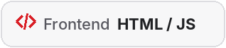
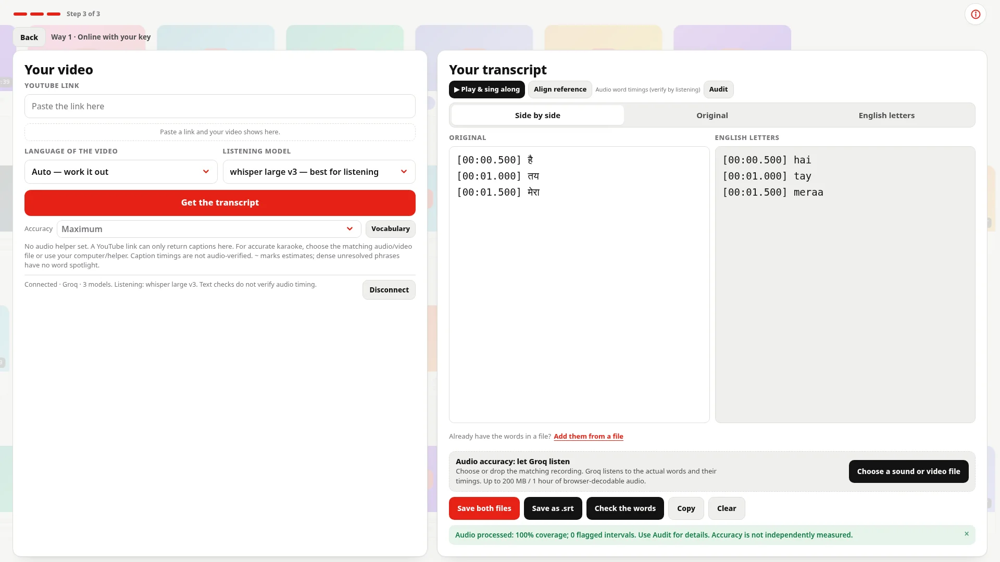
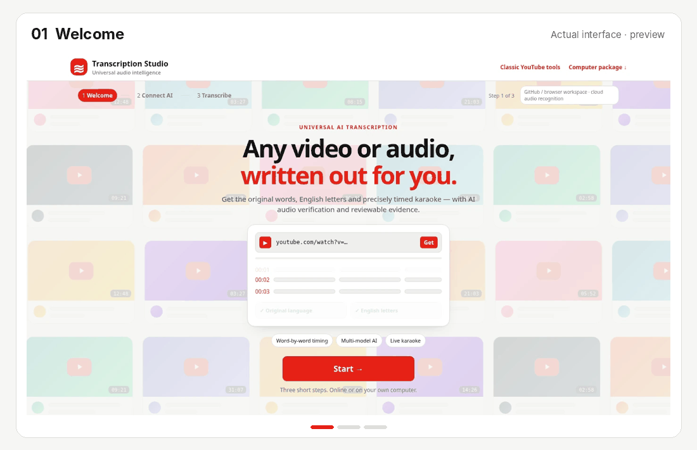
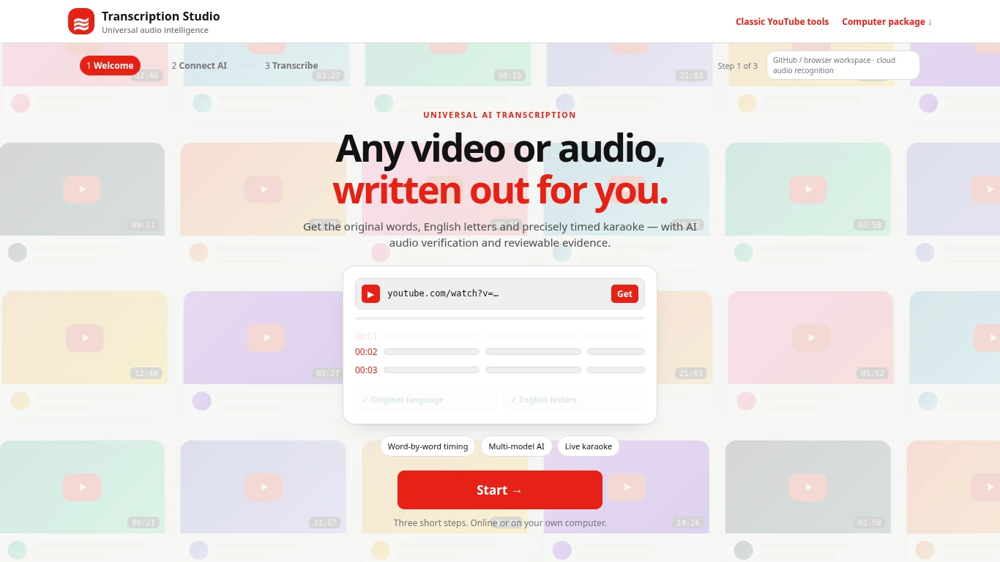
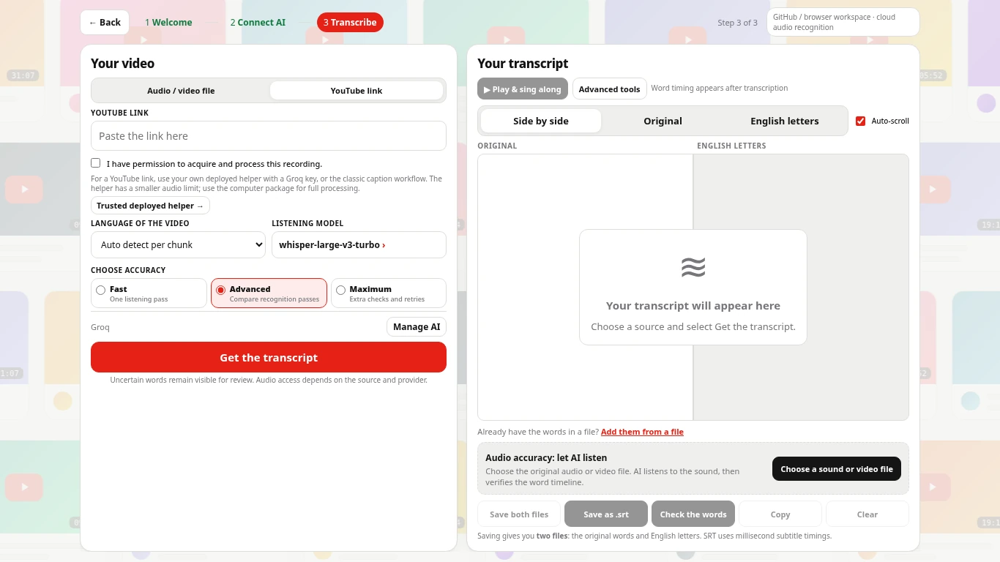
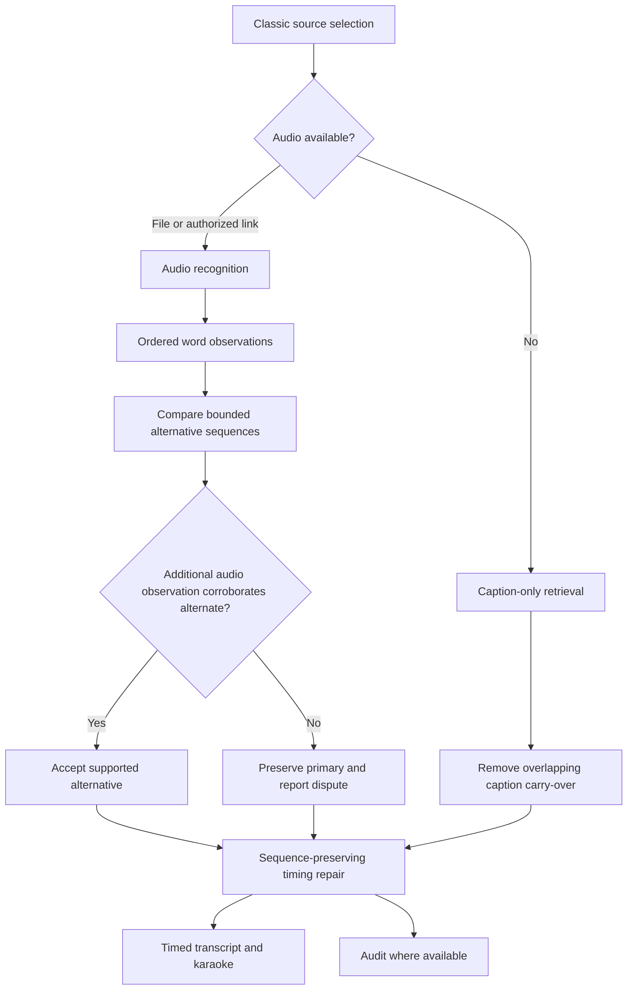
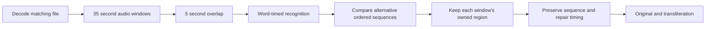
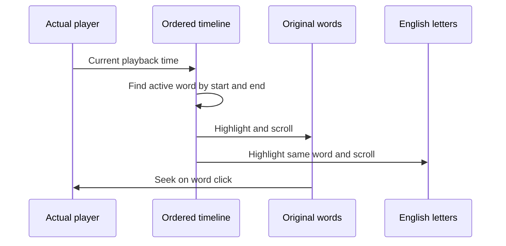
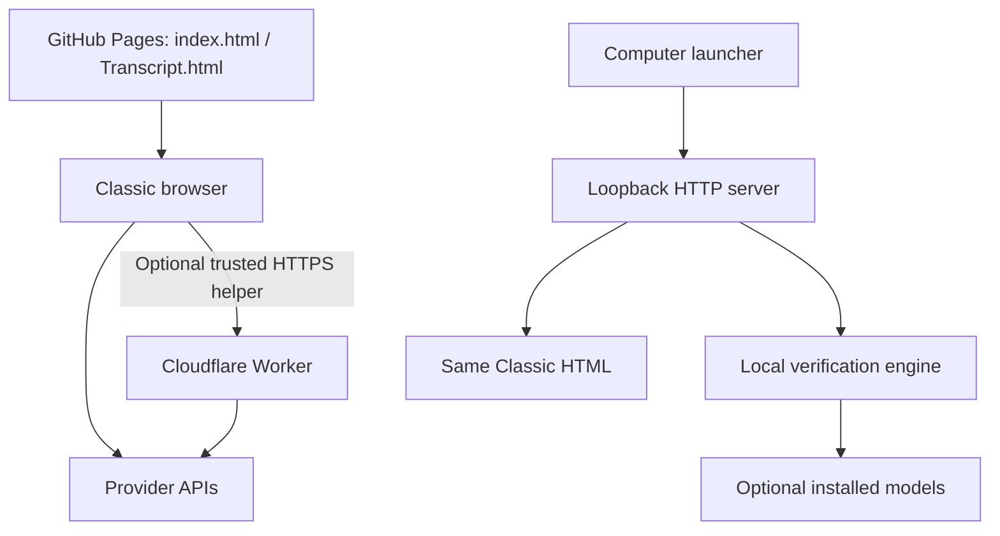
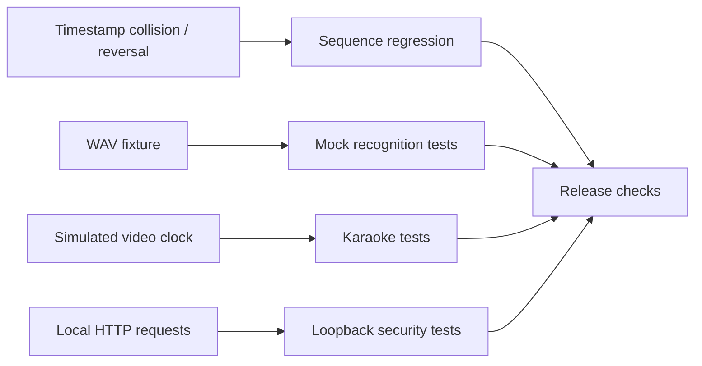

  
  <h1>YouTube Transcribe Downloader</h1>
  
<strong>Classic Precision Edition</strong> · AI transcription · Multilingual text · Synchronized karaoke

  
Transcribe. Compare. Verify. Sing along.

  

    
    
    
    
    
  

  

    
    
  

  
<strong><a href="https://abhishek6966.github.io/Youtube-Transcribe-Downloader/">Open live application</a></strong> · <a href="#computer-package">Computer setup</a> · <a href="#accuracy-engine">Technical guide</a>

  
<a href="#quick-start">Quick start</a> · <a href="#accuracy-engine">Accuracy engine</a> · <a href="#karaoke">Karaoke</a> · <a href="#deployment">Deployment</a> · <a href="#verification">Verification</a>

> One familiar interface. The original animated three-step Classic website is now the sole user-facing application on GitHub Pages and in the computer package. `index.html` and `Transcript.html` contain identical HTML; old bookmarks still work. No separate advanced dashboard is required.

**Live website:** https://abhishek6966.github.io/Youtube-Transcribe-Downloader/  
**Classic direct link:** https://abhishek6966.github.io/Youtube-Transcribe-Downloader/Transcript.html

## Classic Precision 1.3 — pronunciation review and full-screen workspace

Step 3 now uses the available viewport width and height, with larger transcript and karaoke text, bigger video preview and unchanged welcome/connection steps. The document remains fixed; transcripts, compact panels and dialogs can scroll internally on smaller displays.

Maximum mode on the browser Groq/Deepgram audio-file route (with a compatible connected chat model) and the computer engine with Groq context review scans even agreed words for plausible phonetic confusions. It checks at most two candidates per chunk using fresh, unprompted recognition of the matching audio crop. A one-word substitution requires two distinct recognition routes, matching adjacent words and compatible word boundaries; unresolved suggestions remain in the audit. This is not a measurement of accuracy. The direct hosted helper and OpenAI Whisper route do not run this cropped context-review loop.

The **Vocabulary** button accepts up to 180 characters of known spellings in the source language. In Maximum mode, supported Groq / OpenAI Whisper audio routes, the trusted helper and local Whisper can run a separate hinted observation. Hinted recognition is deliberately excluded from automatic consensus; inspect the audit and use the editable transcript or authorized reference for confirmed corrections. No remote model weights are modified. Prompts may bias recognition and do not guarantee pronunciation accuracy. Caption-only results cannot verify the actual spoken or sung sound.

## Quick start

| Step | What to do |
|---|---|
| 1 · Welcome | Open the live web app and press Start. |
| 2 · Connect | Paste a recognized provider key, or select its provider if the key format is ambiguous. The app requests the provider's model catalog. Optional Deepgram connection uses a separate key and accessible project/model-list permissions. |
| 3 · Transcribe | Choose the language (or Auto), accuracy mode, and matching file. A trusted deployed HTTPS helper can attempt YouTube audio processing; without audio access, a link returns captions only. |
| Review | Inspect original text and English-letter pronunciation, listen to the actual recording, and use Check the words for an audio recheck when available. |
| Export | Save TXT or SRT in both scripts, or export the available audit JSON. |

## Accuracy engine

Recognition and timing are separate problems. Sorting individual words by imperfect or overlapping timestamps can corrupt the phrase order. This version preserves provider token sequence, repairs conflicting offsets separately, and labels repaired or inferred word boundaries as **estimated**. It also checks nearby segment-text permutations when the exact same tokens appear in a different order. That comparison is evidence from the same model, not independent proof of the performance.

### Accuracy modes

| Mode | Browser Groq / Deepgram file route | Computer route | Trusted helper |
|---|---|---|---|
| Fast | One available word-timed recognition pass | One available pass | One Whisper pass |
| Advanced | Up to two passes | Multi-model recognition and bounded retries | Up to two Whisper passes |
| Maximum | Up to three observations, plus one targeted retry per disputed chunk | Extra recognition, bounded retries, optional vocal separation and forced alignment | Up to three Whisper observations |

The number of successful passes depends on available models, credentials, audio format, and provider access. Repeated observations from Whisper are **not independent model families**. Deepgram is an optional independent family. Text AI can rank observed alternatives in context; it cannot hear the recording and its suggestions do not automatically rewrite words. OpenAI and Gemini retain their supported direct routes; Gemini times are estimates and its route is not equivalent to the multi-model pipeline.

### Word timing and chunking

Browser decoding supports files up to 200 MB and decoded audio up to one hour on the Groq/Deepgram chunk route. Browser codec support varies. The computer service supports files up to 512 MB and recordings up to four hours, with configured limits and optional local models. Other provider routes have smaller file limits. Acoustic alignment is optional in the computer package, not a browser capability. Audio coverage measures processed audio, not word accuracy.

## Karaoke

Play & Sing Along uses the playback clock from the matching uploaded media or the embedded YouTube player. Both transcript columns share one word timeline. Clicking a word seeks to its start; seeking, pause, and playback update the spotlight. Gaps without a timed word are not filled by a fabricated highlight. Each individual word now shows its millisecond timestamp. `~` indicates an estimate, not an audio-verified boundary. Dense or conflicting caption phrases with insufficient timing evidence are shown as an explicit time range and deliberately excluded from the individual-word spotlight. Real audio recognition and optional acoustic alignment can resolve these passages; a text-only model cannot establish the correct sound timing. SRT uses individual word intervals where available and retains unresolved phrases as ranges. Very short rolling WebVTT display snapshots are removed only when an adjacent cue corroborates the same text. The caption fetcher briefly prefers sources with distinct word offsets over coarse cues. In Maximum mode, the browser can recover unresolved word intervals when two additional audio observations agree on the complete word sequence and compatible timing. This is corroboration, not proof of exact alignment. Embedded playback and audio access depend on the video and browser.

## Computer package

1. Download [offline-pack.zip](offline-pack.zip) and extract it.
2. Install Python 3.12 if needed.
3. Double-click `Open_Transcriber.bat` on Windows. The first run installs dependencies. macOS/Linux users may use `sh start_studio.sh` with a compatible Python environment.
4. The loopback server opens `http://127.0.0.1:8765/` in your browser, showing the same Classic interface.
5. Select the computer/no-key path for local Whisper. A local audio file is recommended; authorized YouTube acquisition may fail due to source availability.
6. For optional Demucs and WhisperX, run `Install_Maximum_Models.bat`. These may require substantial downloads, processing time and compatible hardware.

The local engine retains chunking, optional vocal isolation, optional acoustic alignment, source fingerprinting, bounded retries, quality reports and internal checkpoint support. Classic does not expose every old dashboard configuration: checkpoint opt-in and some detailed model controls remain engine-level settings. API keys are held in the browser tab and sent to a provider or explicitly trusted helper only as needed. Selecting the local no-key route does not send cloud credentials. The helper receives a key only after approval for the link request.

## Deployment

Upload the complete GitHub package contents to the repository. In GitHub Pages settings publish the repository root from the desired branch. Keep both HTML files identical; the root URL opens Classic directly. Deploy the updated `worker/worker.js` separately if you use the helper, following [worker setup](worker/README.md). The helper uses the new `mode` field and can return an additional `third_words` observation. Use only a helper you control or trust and media you are authorized to process.

## Verification

Run `python tests/test_universal.py`, `python tests/test_local_service.py`, `python tests/test_timeline_browser.py`, and `python tests/test_classic_sequence.py`. Browser tests require Playwright and Chromium. `benchmark.py` measures errors against supplied human-annotated ground truth. The tests exercise sequence preservation, timed repetitions, boundary recovery, timing repair, mock recognition with real WAV decoding, karaoke playback logic, and local service access. They do not establish live recognition accuracy on songs. Optional models and Windows launchers have not been exercised end-to-end in this build environment.

**Accuracy limits:** no ASR model guarantees perfect lyrics for every recording or language. Captions can be inaccurate, recognition models can share mistakes, and estimated timings cannot be represented as acoustic truth. Use the exact authorized recording, Maximum mode, and human review of unresolved words for critical karaoke results. No measured accuracy percentage is claimed without independent ground truth.

## Repository guide

| Path | Purpose |
|---|---|
| `index.html`, `Transcript.html` | Same original Classic user interface and browser engine |
| `universal_engine.py`, `universal_server.py` | Computer processing and local job endpoints |
| `server.py` | Local HTTP server |
| `worker/` | Optional deployed helper |
| `mcp-server/` | Legacy and advanced local audio MCP tools |
| `docs/readme/` | Locally bundled animated graphics and UI captures |
| `tests/` | Deterministic software regression suite |
| `benchmark.py` | Reference-based accuracy metrics |

See [license](LICENSE) and [contribution guide](CONTRIBUTING.md). Animated graphics illustrate the workflow; mock screenshots are not real verified song results.
