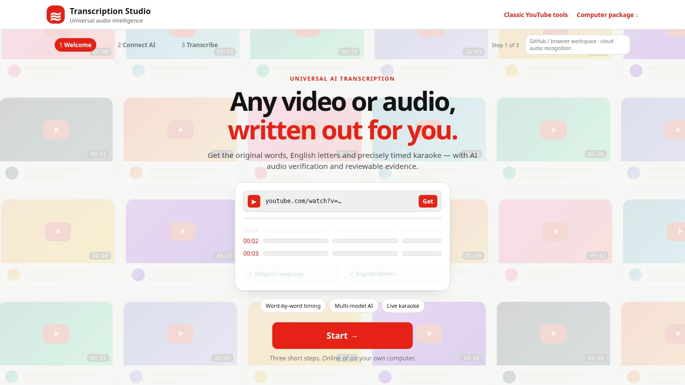
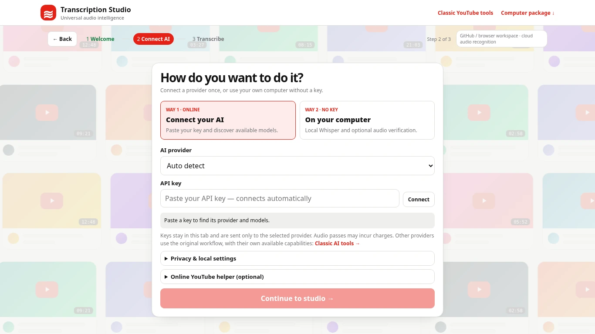
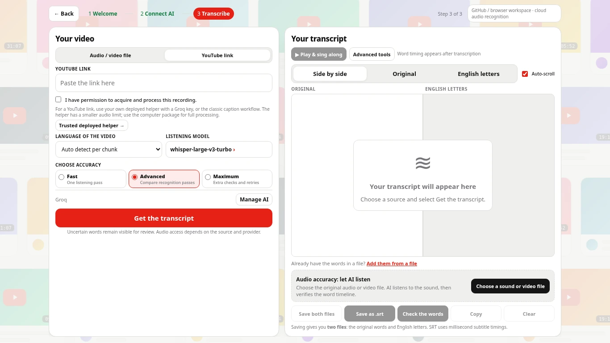

# Universal Transcription Studio 1.0

## Start in one click

**Windows:** extract the ZIP (do not run from inside the ZIP), install Python 3.12 if you don't already have it, and double-click `Open_Transcriber.bat`. First start creates a private Python environment and installs the core dependencies. The server then opens `http://127.0.0.1:8765/` in your browser. It stays on your computer; close the terminal to stop it. The first local recognition job downloads the selected Whisper model(s); allow several GB of disk space and sufficient RAM. CPU recognition, especially on music, can take significant time. For macOS/Linux run `sh start_studio.sh` in the extracted folder. These launchers have not been tested on Windows/macOS in this build environment.

1. Choose an authorized audio/video file, or enter a YouTube URL and confirm permission to process the recording.
2. Choose Fast, Advanced (default), or Maximum. Leave language on Auto unless you know it. In the computer package, no cloud key is needed when local Whisper is installed.
3. Click **Get the transcript**. Read the progress and quality report; tap a word to listen to its time interval and view the competing predictions. Export TXT, SRT or audit JSON. Click the original or English-letter view if you prefer one column.

To use independent cloud recognition, open **Recognition engines & privacy** and enter a Groq and/or Deepgram key. Only connect providers to which you consent to sending your audio. A key is not required for local-only processing. The models may be paid; multiple passes cost more. Keys are kept only in session memory, not embedded in files or reports. With checkpoints enabled, audio hashes, transcript words, and raw recognition evidence are saved in `.studio-cache`; clear them from the UI. Re-running the identical source and processing settings reuses completed eligible chunks. A stopped job may be restarted, not continued by a background agent. Checkpoints are opt-in, not encrypted; protect the local folder.

**Optional maximum models:** close the studio, then run `Install_Maximum_Models.bat` or `.venv/bin/python -m pip install -r requirements-maximum.txt` on macOS/Linux. This installs Demucs and WhisperX. These optional dependencies can be large, may have platform-specific compatibility requirements, and require model downloads. They are invoked when present in Maximum mode; if unavailable or failing, the application reports the fallback instead of marking verification complete. Local CPU mode currently uses int8 recognition. Forced alignment is only possible for supported languages; singing and overlapping speakers can still be difficult.

## GitHub Pages

Upload the complete repository, including `index.html`, `studio.js`, `studio.css`, `Transcript.html` and `offline-pack.zip`. Enable Pages from the repo root. The new home page is the Universal Studio. Browser audio-first processing decodes supported files locally and sends overlapping 35-second WAV chunks to configured Groq/Deepgram endpoints. This requires provider/browser access and a key. It is limited to 200 MB and one hour of decoded audio to protect browser memory. The browser does not execute Demucs, WhisperX or local Whisper. It has a basic Hindi romanization fallback; other scripts may remain unchanged. Use the computer package for language-specific romanization, vocal separation and forced alignment.

`Transcript.html` retains the prior YouTube link / caption / helper workflow and previous export and karaoke features. Link-only online transcription still depends on the existing helper and source accessibility. The new browser studio can call your explicitly configured, trusted existing helper for an authorized link using Groq, with limited word reconciliation and unknown full-source coverage. It does not itself download YouTube streams. Direct cloud calls may be blocked by CORS or provider policy; use the computer package or the existing trusted helper workflow. No access restrictions are bypassed or guaranteed. Use media you are entitled to process.

## What is implemented

- Ordered, timestamp-aware sequence alignment; genuine repeats preserved; leading/trailing omissions exposed or recovered when supported by multiple recognition routes.
- Groq Whisper large-v3/turbo, local faster-whisper large-v3/turbo, optional independent Deepgram Nova-3. Alternate candidates are never generated from remembered lyrics. Two Whisper variants are correlated; agreement is not proof. Models are attempted in priority order, with bounded fallback.
- Overlapping chunks, explicit processed duration, source fingerprint, provider evidence, quality warnings, and optional computer-side checkpoints. Audio duration limit: 4 hours and 512 MB input on computer. Browser limits differ.
- Maximum mode: optional Demucs vocal isolation, fallback audio noise reduction, up to two targeted retry intervals per local chunk, optional WhisperX forced alignment, raw evidence. Browser supports targeted retry evidence but not acoustic alignment.
- Local speech activity heuristic when Silero VAD is available, plus sound-energy audit. These identify possible gaps, not definitive missing lyrics. Provider confidence and segment metadata are retained but not treated as calibrated probability of correctness.
- Auto language selection per chunk; Deepgram multilingual mode when auto is selected; local Whisper multilingual option if supported. Deepgram optional speaker labels are chunk-local, not stable cross-recording speaker IDs. Overlapping voice separation is not implemented.
- Optional Groq text-only context suggestions for observed disputed candidates (opt-in, never edits the transcript; API model availability may vary).
- Reference comparison with user-supplied authorized lyrics/transcript; it flags differences and never silently replaces words. A published lyric sheet is not ground truth for a different recording.
- Local/browser word evidence, manual corrections with undo, millisecond SRT, simultaneous karaoke highlighting, auto-scroll, source playback when supported by the browser/YouTube embed. No automated syllable timings or actual singing-specialized acoustic model in this release.
- Local API runs on loopback, validates Host and Origin, restricts new link inputs to HTTPS YouTube video URLs, uses fixed provider API URLs, limits input and concurrency, does not store keys. Local MCP `verify_local_audio` invokes the same Python engine. Existing classic worker/legacy routes are retained; they do not all share the full pipeline. Browser verification is a JS port of the Python consensus algorithm, not a single shared implementation.
- `benchmark.py` evaluates human-annotated reference words against audit JSON: WER, CER, insertions, deletions, substitutions, and timing error. It does not create ground truth, calibrate confidence, or automatically download datasets.

## Limitations and release verification

No universal 100% transcription accuracy. This release includes genuine software regression tests but does not include live provider results, downloaded Whisper model weights, real multilingual or song benchmark results, calibrated accuracy, or a guarantee of correct transcription. OpenAI/Gemini remain supported in the classic workflow; the advanced pipeline does not yet include their audio models or IndicConformer. The optional Demucs and WhisperX integrations have not been run end-to-end here. There is no cross-chunk speaker identity or syllable-level singing alignment. Direct links, provider availability, licensing, hardware and API limits remain external constraints. The browser and Python pipelines differ where browser capabilities are limited. The quality report labels evidence and uncertainty, not accuracy.

## Tests

Run `python tests/test_universal.py`, `python tests/test_local_service.py`, and (with Playwright and Chromium installed) `python tests/test_studio_browser.py` and `python tests/test_timeline_browser.py`. Browser tests simulate provider results and the legacy YouTube player; new browser tests decode a real synthetic WAV. Loopback tests use a mocked recognition engine. To measure real performance, use a legally obtained recording and human-annotated word array `[ {"text":"word", "start":0.1, "end":0.4} ]`, and run `python benchmark.py human.json transcript-audit.json --output metrics.json`. Measure on different languages, accents, songs, and noise levels before advertising performance. For languages without whitespace word boundaries, use language-appropriate tokenization for WER or CER.

## Three-step studio

1. **Welcome** — animated preview and Start.
2. **Connect AI** — paste a Groq key for automatic live discovery, or select Deepgram if its key format is ambiguous. Groq selects only available supported Whisper models; Deepgram checks its project catalog for Nova-3 (project/model-list permissions are required). The other original AI providers connect through the Classic workflow in the same tab, with in-memory credential handoff. They do not gain advanced audio consensus capabilities. Unknown key formats require explicit provider selection. Keys are not saved in URLs or browser storage.
3. **Transcribe** — the source and player are on the left; transcript and exports are on the right. Word evidence and quality reports open in-panel. On small screens or when expanding settings, the relevant panel scrolls instead of the outer page. The computer route can continue without a key when local Whisper is installed.

| Welcome | Connect AI | Workspace |
| --- | --- | --- |
|  |  |  |

Model catalog tests use simulated provider responses; live keys and permissions still need real-world testing.

## Restored workspace controls

Step 3 defaults to a YouTube link and shows the original-style preview when a valid ID is entered. The audio tab and upload panel select local media. Listening models are automatically selected from connected supported engines; Manage AI opens the provider connection page. The trusted helper is configured on Step 2. Check the words offers a fresh Maximum-mode audio pass, with confirmation before a successful run replaces the current result. Imported SRT, VTT and timestamped TXT are explicitly estimated at word level. Advanced tools contains the reference field (used on the next run), word evidence, quality and JSON export. The original Classic workflow remains in `Transcript.html`.

Live site: https://abhishek6966.github.io/Youtube-Transcribe-Downloader/
